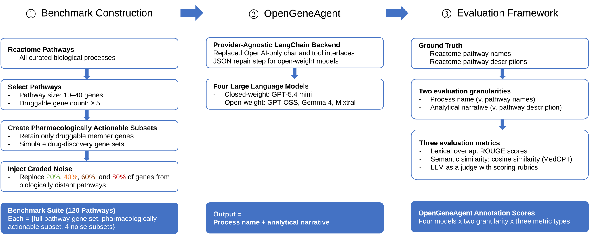

# Project Overview
## Title
OpenGeneAgent: A Provider-Agnostic Benchmark for Self-Verifying Gene Set Analysis Agents Under Realistic Biological Noise

## Abstract
Agentic AI systems are emerging to assist knowledge-intensive gene-set analysis for drug discovery, aiming to reduce hallucination through tool-use and self-verification against external biomedical databases. Existing systems such as GeneAgent, however, primarily rely on proprietary commercial LLMs and are evaluated on idealized gene sets that do not capture the noise and heterogeneity of real-world genomic analyses ([ref 1][reference]).

This repository provides **OpenGeneAgent**, a provider-agnostic reimplementation of GeneAgent's self-verifying agentic workflow. It replaces the original OpenAI-only framework with a unified LLM client (built on [BaseAgent](https://github.com/BinglanLi/BaseAgent)) so the same cascade of hypothesis generation, domain-specific tool-use, claim verification, and revision can run against proprietary APIs (OpenAI, Azure OpenAI) or open-weight models served locally via Ollama (e.g. GPT-OSS-20B, Gemma4:26B, Mixtral 8x22B).

To evaluate agentic AI under realistic biological noise, we built a benchmark suite derived from Reactome pathways. Each pathway is represented by its complete reference gene set, a pharmacologically actionable subset (genes with documented drug-gene interactions), and four progressively noisier variants created by substituting increasing proportions of genes with genes from unrelated pathway categories. Predictions are scored with both embedding-based semantic similarity (MedCPT) and a few-shot LLM-as-judge metric designed to capture biological fidelity and mechanistic correctness beyond what lexical/semantic overlap can measure.




# Requirement
- Python >= 3.12, < 3.13
- See `pyproject.toml` for the complete dependency list

## Core Dependencies
- `baseagent` - Unified LLM/agent framework (installed from https://github.com/BinglanLi/BaseAgent)
- `openai >= 1.0.0` - OpenAI-compatible API client
- `langchain-core`, `langchain-openai`, `langchain-ollama`, `langgraph` - LLM integration and workflow orchestration
- `pydantic >= 2.0.0` - Data validation
- `pandas`, `numpy`, `scipy` - Data manipulation and statistics
- `transformers`, `torch` - MedCPT embedding model for semantic similarity scoring
- `rouge-score`, `nltk`, `gensim` - Lexical evaluation metrics
- `plotly`, `seaborn`, `kaleido` - Visualization and figure export
- `requests`, `requests-oauthlib` - HTTP clients for domain database APIs
- `tiktoken` - Token counting
- `python-dotenv` - Environment variable management

## Optional Dependencies
- `langchain-anthropic` - For Anthropic Claude models
- `langchain-aws` - For AWS Bedrock models

# Datasets
- **AlzKB** (`Datasets/AlzKB/`): the primary benchmark used in this study. Reactome pathways sampled from AlzKB, each with a `full_set` (complete reference genes), a `reduced_set` (pharmacologically actionable subset with documented drug-gene interactions), and four noise-perturbed variants (`noise_20`, `noise_40`, `noise_60`, `noise_80`) where an increasing percentage of genes are substituted with genes from unrelated pathways.
- **Gene Ontology** (`Datasets/GeneOntology/`): 1000 gene sets from the GO:BP branch of the gene ontology database.
- **MsigDB** (`Datasets/MsigDB/`): 56 gene sets including the hallmark gene sets.
- **NeST** (`Datasets/NeST/`): 50 gene sets sampled from human cancer proteomic data.

> [Note] The Gene Ontology, MsigDB, and NeST were forked from the original [GeneAgent GitHub repository](https://github.com/ncbi-nlp/GeneAgent).

# Configuration
## Installation

### Method 1: Using UV (Recommended)

1. Clone the repository:
   ```bash
   git clone git@github.com:BinglanLi/OpenGeneAgent.git
   cd OpenGeneAgent
   ```

2. Install uv if you haven't already:
   ```bash
   curl -LsSf https://astral.sh/uv/install.sh | sh
   ```

3. Create environment and install all dependencies (including BaseAgent from GitHub):
   ```bash
   uv sync
   ```

4. Activate the environment:
   ```bash
   source .venv/bin/activate
   ```

5. (Optional) Install with additional LLM provider support:
   ```bash
   uv sync --extra anthropic  # For Anthropic Claude models
   uv sync --extra bedrock    # For AWS Bedrock models
   uv sync --extra all        # For all optional providers
   ```

### Method 2: Using pip

1. Clone the repository:
   ```bash
   git clone git@github.com:BinglanLi/OpenGeneAgent.git
   cd OpenGeneAgent
   ```

2. Create a virtual environment:
   ```bash
   python -m venv .venv
   source .venv/bin/activate  # On Windows: .venv\Scripts\activate
   ```

3. Install dependencies:
   ```bash
   pip install .
   ```

4. (Optional) Install with additional LLM provider support:
   ```bash
   pip install ".[anthropic]"  # For Anthropic Claude models
   pip install ".[bedrock]"    # For AWS Bedrock models
   pip install ".[all]"        # For all optional providers
   ```

### Note on BaseAgent

BaseAgent is automatically installed from https://github.com/BinglanLi/BaseAgent (pinned to a specific commit in `pyproject.toml`'s `[tool.uv.sources]`).

## Configure LLM Credentials

Before running OpenGeneAgent, configure your LLM provider credentials, either via environment variables or a `.env` file (see `.env.example`).

**For OpenAI:**
- `OPENAI_API_KEY`

**For Azure OpenAI:**
- `AZURE_OPENAI_API_KEY`
- `AZURE_OPENAI_ENDPOINT`
- `AZURE_OPENAI_API_VERSION`
- Use model names with an `azure-` prefix (e.g., `azure-gpt-5.4-mini`)

**For Azure AI Foundry (optional, e.g. Claude judge models):**
- `AZURE_FOUNDRY_BASE_URL`
- `AZURE_FOUNDRY_API_KEY`

**For Ollama (open-weight models):**
- Ollama must be running and reachable (default `http://localhost:11434/v1`, configurable via `OLLAMA_BASE_URL`)
- Use model names as pulled in Ollama (e.g. `gpt-oss:20b`, `gemma4:26b`, `mixtral:8x22b`)
- See [Set up Ollama on HPC](#set-up-ollama-on-hpc) below for cluster setup

The code (`llm_utils.py`) automatically detects the provider based on the model name:
- Models starting with `gpt-` or `o1-` → OpenAI API
- Models starting with `azure-` → Azure OpenAI or Azure AI Foundry
- Models containing `:` or known Ollama model names (e.g. `gpt-oss`, `gemma4`, `mixtral`) → Ollama (OpenAI-compatible endpoint)
- Models starting with `claude-` → Anthropic (via BaseAgent)
- Other models → auto-detected by BaseAgent

>[!NOTE]
>OpenGeneAgent uses unified LLM infrastructure (`llm_utils.py`), which provides a single interface across OpenAI, Azure, Anthropic, AWS Bedrock, and Ollama.

## Set up Ollama on HPC

1. Download and extract the Ollama Linux binary in a folder of your choice.
   ```bash
   # create the directory
   mkdir -p ~/ollama
   cd ~/ollama
   # install
   curl -L https://ollama.com/download/ollama-linux-amd64.tar.zst -o ollama-linux-amd64.tar.zst
   # extract
   zstd -d ollama-linux-amd64.tar.zst -c | tar -xf - -C ~/ollama
   ```

2. Configure the environment variables by adding the following lines in `~/.bashrc` or` ~/.zshrc`.
   ```bash
   # Add the binary to your PATH so you can type 'ollama' instead of the full path
   export PATH=$HOME/ollama/bin:$PATH

   # (Optional) Set a custom path for models if you want them somewhere specific
   # If you skip this, they will default to ~/.ollama/models (which is fine for most users)
   export OLLAMA_MODELS=$HOME/ollama/models
   ```

3. Run the Ollama server
   ```bash
   # & symbol runs the Ollama server in the background
   ollama serve &
   ```

4. Download models before use
   ```bash
   # Pull the models you want to use
   ollama pull gpt-oss:20b
   ollama pull gemma4:26b
   ollama pull mixtral:8x22b

   # Verify available models
   ollama list
   ```
   > [!NOTE]
   > Models must be pulled explicitly before use. Ollama will return an error if you reference a model that has not been downloaded.

5. (Optional) Create a simple script to manage the Ollama server without `sudo`.
   Create a new file named `ollama-manager.sh` with the following content under the `~/ollama/` folder.
   ```bash
   #!/bin/bash

   # --- CONFIGURATION ---
   INSTALL_DIR="$HOME/ollama"
   export OLLAMA_MODELS="$INSTALL_DIR/models"
   export PATH="$INSTALL_DIR/bin:$PATH"

   PID_FILE="$INSTALL_DIR/ollama.pid"
   LOG_FILE="$INSTALL_DIR/server.log"
   OLLAMA_HOST="${OLLAMA_HOST:-127.0.0.1:11434}"
   # ---------------------

   # Helper: Check if a PID is actually an ollama process
   is_ollama_running() {
      local pid="$1"
      if [ -n "$pid" ] && kill -0 "$pid" 2>/dev/null; then
         # Verify it's actually an ollama process, not a recycled PID
         if ps -p "$pid" -o comm= 2>/dev/null | grep -q "ollama"; then
               return 0
         fi
      fi
      return 1
   }

   case "$1" in
      start)
         if [ -f "$PID_FILE" ]; then
            OLD_PID=$(cat "$PID_FILE")
            if is_ollama_running "$OLD_PID"; then
               echo "Ollama is already running (PID: $OLD_PID)."
               exit 0
            else
               echo "Removing stale PID file..."
               rm -f "$PID_FILE"
            fi
         fi

         echo "Starting Ollama..."
         nohup ollama serve > "$LOG_FILE" 2>&1 &
         NEW_PID=$!
         echo $NEW_PID > "$PID_FILE"

         # Wait briefly and verify it actually started
         sleep 2
         if is_ollama_running "$NEW_PID"; then
            echo "Ollama started! (PID: $NEW_PID)"
            echo "Logs are being written to: $LOG_FILE"
         else
            echo "ERROR: Ollama failed to start. Check logs: $LOG_FILE"
            rm -f "$PID_FILE"
            exit 1
         fi
         ;;
      stop)
         if [ -f "$PID_FILE" ]; then
            PID=$(cat "$PID_FILE")
            if is_ollama_running "$PID"; then
               echo "Stopping Ollama (PID: $PID)..."
               kill "$PID"
               # Wait for graceful shutdown (up to 10 seconds)
               for i in {1..10}; do
                     if ! kill -0 "$PID" 2>/dev/null; then
                        break
                     fi
                     sleep 1
               done
               # Force kill if still running
               if kill -0 "$PID" 2>/dev/null; then
                     echo "Force killing..."
                     kill -9 "$PID" 2>/dev/null
               fi
               rm -f "$PID_FILE"
               echo "Ollama stopped."
            else
               echo "PID file exists but process is not running. Cleaning up..."
               rm -f "$PID_FILE"
            fi
         else
            echo "Ollama is not running (no PID file)."
            # Fallback cleanup
            pkill -u "$USER" -x ollama 2>/dev/null && echo "Cleaned up stray ollama processes."
         fi
         ;;
      restart)
         "$0" stop
         sleep 2
         "$0" start
         ;;
      status)
         if [ -f "$PID_FILE" ]; then
            PID=$(cat "$PID_FILE")
            if is_ollama_running "$PID"; then
               echo "✅ Ollama is RUNNING (PID: $PID)"
               # Optionally check if the server is responding
               if curl -s --max-time 2 "http://${OLLAMA_HOST}/api/tags" >/dev/null 2>&1; then
                     echo "   API is responding at http://${OLLAMA_HOST}"
               else
                     echo "   ⚠️  Process running but API not responding yet"
               fi
            else
               echo "🔴 Ollama is STOPPED (stale PID file found)"
               rm -f "$PID_FILE"
            fi
         else
            echo "🔴 Ollama is STOPPED"
         fi
         ;;
      *)
         echo "Usage: $0 {start|stop|restart|status}"
         exit 1
         ;;
   esac
   ```

   Make the file executable:
   ```bash
   chmod +x ~/ollama/ollama-manager.sh
   ```

   Use the file:
   ```bash
   ~/ollama/ollama-manager.sh start
   ~/ollama/ollama-manager.sh status
   ~/ollama/ollama-manager.sh stop
   ```

# Execute
## Architecture
OpenGeneAgent refactored the following to a unified LLM infrastructure. These scripts 
- **`main_cascade.py`**: the core self-verification cascade (hypothesis → claim generation → verification → revision) for a single dataset/model
- **`worker.py`**: `AgentPhD` class implementing claim verification via function calling against the domain APIs

The following is unique to OpenGeneAgent:
- **`llm_utils.py`**: unified LLM client supporting multiple providers (OpenAI, Azure, Anthropic, Bedrock, Ollama)
- **`costs.py`**: tracks per-model token usage and estimated USD cost across a run
- **`run_geneagent.py`**: batch driver that runs `main_cascade.py` over every gene-set condition (`full_set`, `reduced_set`, `noise_20`...`noise_80`) in a benchmark CSV
- **`evaluate_pathway_predictions.py`**: scores predictions against reference Reactome pathway names using ROUGE, MedCPT semantic similarity, and an optional LLM-as-judge pass
- **`check_completion.py`**: audits `Outputs/` for incomplete (model, part, noise-level) runs and regenerates the SLURM incomplete-task list


## Running OpenGeneAgent
Run the self-verification cascade on one gene-set condition:
```bash
python main_cascade.py --input Datasets/MsigDB/MsigDB_toy.csv --llm gpt-4o
```
Key options (`python main_cascade.py --help` for the full list):
- `--llm`: model name, e.g. `gpt-4o`, `azure-gpt-5.4-mini`, `gpt-oss:20b`
- `--output`: output directory (default: `Outputs/{llm}/{dataset_name}`)
- `--resume`: skip gene sets already processed
- `--cleanup-memory`: unload the Ollama model after each gene set to avoid OOM

Results (`Baseline_LLM_Responses.txt`, `Claims_and_Verification_Topic.txt`, `Claims_and_Verification_Analytic_Narratives.txt`, `Final_Response_GeneAgent.txt`, `Usage_Totals.txt`, `Error_Report.txt`) are written to the output directory.

## Running the full noise benchmark
`run_geneagent.py` sweeps every gene-set column (`full_set`, `reduced_set`, `noise_20`, `noise_40`, `noise_60`, `noise_80`) in an AlzKB-style benchmark CSV, invoking `main_cascade.py` for each:
```bash
python run_geneagent.py --input Datasets/AlzKB/sampled_noise_toy.csv --llm gpt-oss:20b
```
Use `--skip-columns` to omit already-completed conditions and `--limit` to test on a subset of pathways.

Then score the predictions against the reference pathway names:
```bash
python evaluate_pathway_predictions.py --input Datasets/AlzKB/sampled_noise_toy.csv --llm gpt-oss:20b --judge-llm azure-claude-haiku-4-5
```
Add `--include-descriptions` to additionally score the full mechanistic analytic narrative (rather than just the predicted process name) against the curated Reactome description.


### Example gene-set analysis outputs
```
Process: MAPK Signaling Pathway
The proteins encoded by the genes ERBB2, ERBB4, FGFR2, FGFR4, HRAS, and KRAS are all integral components of the MAPK signaling pathway, which is crucial for cell growth, differentiation, and survival.
ERBB2 and ERBB4 are members of the epidermal growth factor receptor (EGFR) family of receptor tyrosine kinases (RTKs). ERBB2 is unique in that it has no known ligands, and it prefers to form heterodimers with other EGFR family members, enhancing their kinase activity. ERBB4 is activated by neuregulins and other factors and induces a variety of cellular responses including mitogenesis and differentiation.
FGFR2 and FGFR4 are part of the fibroblast growth factor receptor (FGFR) family of RTKs. They are activated by fibroblast growth factors, leading to receptor dimerization and autophosphorylation. This triggers downstream signaling pathways that regulate cellular processes such as proliferation, differentiation, and migration.
HRAS and KRAS are GTPases that act as molecular switches in RTK signaling. They are activated by guanine nucleotide exchange factors (GEFs) that catalyze the exchange of GDP for GTP. Once activated, RAS proteins can interact with a variety of effector proteins to propagate the signal downstream.
The interaction between these proteins forms a complex network of signaling events that regulate key cellular processes. Dysregulation of this system, such as mutations that lead to constitutive activation of RTKs or RAS proteins, can result in uncontrolled cell growth and cancer. Therefore, understanding the precise mechanisms of MAPK signaling and its regulation is crucial for the development of targeted cancer therapies.
```

### Evaluating the outputs
OpenGeneAgent predictions are scored two ways:
1. **Semantic similarity (MedCPT)** and **ROUGE** — metrics used in GeenAgent - computed directly in `evaluate_pathway_predictions.py`.
2. **LLM-as-judge** — a few-shot, Prometheus-style rubric (see `evaluate_pathway_predictions.py`) that scores predictions on a 1–4 scale, separately for the predicted process name (title equivalence, accounting for Reactome's pathway hierarchy) and for the full analytic narrative (mechanistic fidelity, hallucinated genes, contradictory claims). Enable it with `--judge-llm <model>`.

Detailed per-pathway results are saved to `Outputs/{llm}/evaluation_results_processNames.csv` and `evaluation_results_analyticNarratives.csv`.


## Acknowledgements
This work builds on [GeneAgent](https://github.com/ncbi-nlp/GeneAgent) [DOI: 10.5281/zenodo.15008591](https://zenodo.org/records/15008591) and is sponsored by U01 AG066833, R01 LM014572, and P30 AG094848.

[reference]: #reference
## References
1. Wang, Z., Jin, Q., Wei, CH. et al. GeneAgent: self-verification language agent for gene-set analysis using domain databases. Nat Methods 22, 1677–1685 (2025). https://doi.org/10.1038/s41592-025-02748-6
